# Asiri architecture

Asiri lets an AI agent **use** a secret without **seeing** it. The agent asks by reference (`asiri://dev/github`), the person approves, and Asiri delivers the value straight to the process that needs it. The agent gets the result back, never the value.

This document covers v0.1: one person, one machine, one or a few agents. Product scope and milestones are in the design note; this file covers how the system is built and why.

Status: M1–M4 built (vault, server, pairing, `add`/`ls`, grants, `asiri run`, scrubbing, approvals from Rex, the terminal or `asiri approve`, `asiri rex install`, SSH keys that sign inside the server); M5+ is design. Decided 2026-11-20: Apache-2.0, port 7420, a bare Return on an approval means "allow once".

---

## 1. Requirements

### Functional
| # | Use case | API verb |
|---|---|---|
| F1 | Person stores a secret, or imports Apple/Google password CSVs | `PutItem`, `Import` |
| F2 | Agent lists which secrets exist (metadata only) | `ListItems` |
| F3 | Agent runs a command with secrets delivered as env, stdin or a one-time file | `CreateRequest` → `Decide` → `Redeem` |
| F4 | Agent uses a stored SSH key without the key leaving the server | `Sign` |
| F5 | Person approves or denies each use: once, 15 min, 1 h | `Decide` |
| F6 | Person revokes grants, one or all | `Revoke`, `RevokeAll` |
| F7 | Person reads and verifies a tamper-evident audit log | `ListAudit`, `VerifyAudit` |

### Non-functional
| Property | Target | Why |
|---|---|---|
| Confidentiality | No secret in the agent's context, the command output it reads, logs, or on disk in plaintext | the whole point |
| Fail closed | Server down, sealed, or approval unclear → no secret | a broker that fails open is worse than none |
| Latency (machine part) | request → redeem under 20 ms on localhost, excluding the human | approvals are human-paced; the rest must feel instant |
| Output overhead | scrubber ≥ 200 MB/s, adds under 1 ms per chunk | must not slow builds or logs |
| Availability | single process; restarts in under 1 s; `restart: unless-stopped` | local tool, no SLO beyond "comes back" |
| Durability | no committed write lost on crash (SQLite WAL, `synchronous=FULL`); encrypted backups | losing the vault is the worst failure |
| Consistency | strong, single writer | grants and uses must never double-spend |
| Portability | macOS first; Linux works; server is a container | the person's setup |

### Estimates (one person, heavy agent use)

```
Items:        ~1,000 (incl. imported logins) × ~1 KB ciphertext+meta   ≈ 1 MB
Requests:     ~300/day typical; burst: 10 agents × 1 req/s             = 10 req/s peak
Redeems:      ≈ requests (once) + reuse within 15m/1h grants           ≈ 20 req/s peak
SSH signs:    ~50/day; Ed25519 sign ≈ 50 µs                            ≈ nothing
Audit:        ~1,500 events/day × ~400 B                               ≈ 0.6 MB/day ≈ 220 MB/year
DB total:     < 300 MB after a year
SQLite:       > 10,000 simple writes/s in WAL on an SSD                → ~500× headroom
```

**What the numbers say:** one process, one SQLite file, no cache, no queue, no sharding, no replicas. Everything below is chosen for security and correctness, not scale. The only scale-shaped mechanism is a per-client rate limit, and that is there to catch runaway or hijacked agents, not to protect capacity.

---

## 2. System overview

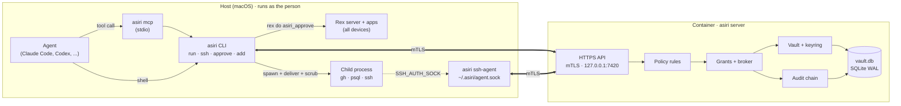

**Trust boundaries**
1. **Agent ↔ CLI.** The agent controls the CLI's arguments but never receives values. The CLI is the only place values exist on the host, and only in memory.
2. **CLI ↔ server.** mTLS with pinned CA; the client's certificate carries its role (`owner` or `agent`).
3. **Server ↔ disk.** Every secret value on disk is encrypted. The master key never touches disk inside the container except as a mounted Docker secret. The TLS keys in `/data/tls` (CA and server, 0600) are plain files: they prove identity, they don't decrypt anything. Keeping the CA key outside the vault lets a locked (passphrase-mode) server still pair its first owner, who then unlocks it.

---

## 3. Mechanisms and the force behind each

| Mechanism | Force it addresses |
|---|---|
| Split server (container) and CLI (host) | the vault must live in the container (person's choice) but delivery must happen where the agent's process runs |
| mTLS over TCP on 127.0.0.1 | Docker Desktop on macOS can't share unix sockets across its VM; we need caller identity and role per request |
| Envelope encryption (KEK → VK → DEK) | re-key or change passphrase without re-encrypting every item; per-item keys limit what one bug exposes |
| AEAD with AAD = item, version, field | stops moving a ciphertext onto another item or rolling back a version |
| Grants with `uses_left` + expiry, atomic conditional update | approvals must never be spent twice, even with concurrent redeems |
| First-decision-wins (conditional update on `status='pending'`) | Rex shows the prompt on every device; two answers can race |
| Long polling `GET /v1/requests/{id}?wait=30s` | the CLI must learn the decision quickly without a WebSocket tier; decisions are rare |
| Audit row written in the **same transaction** as the state change | no dual write; the log can't say "approved" when the grant wasn't created, or the reverse |
| Hash-chained audit | detect edits or deletions after the fact |
| Per-client token bucket (30/min, burst 10) | a looping or hijacked agent hammering requests; also raises an `anomaly` audit event |
| Server-side SSH signing + `session-bind` host check | the private key never leaves the container; the key is only used for allowed hosts |
| Streaming scrubber on child output | values (and encoded forms) must not reach the agent by accident |
| Binary allow-list + interpreter deny-list | the real defence: a shell can print or exfiltrate anything it's given |
| Approver fallback chain (Rex → tty → wait) | Rex may be closed, busy or unsupported; there may be no tty |

---

## 4. Main flows

### 4.1 `asiri run` with a Rex approval

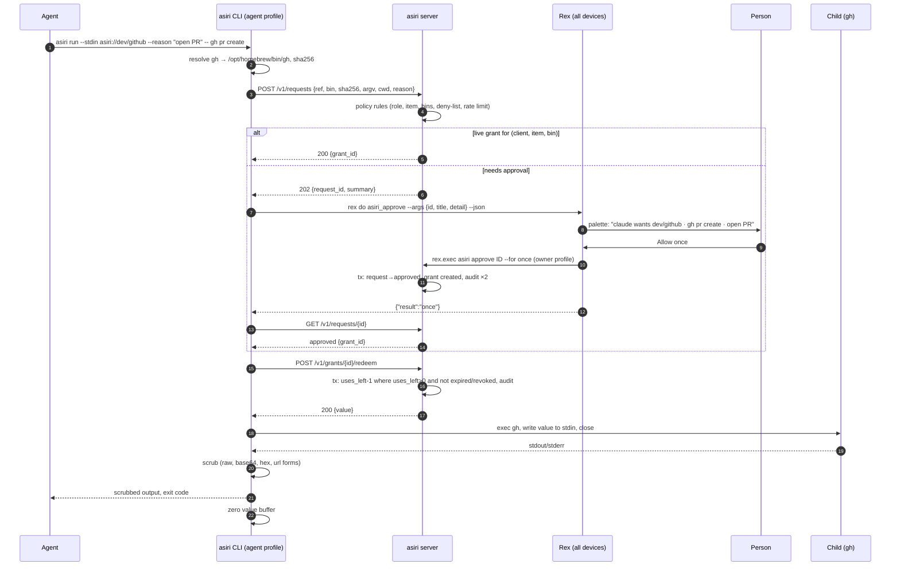

### 4.2 SSH signing

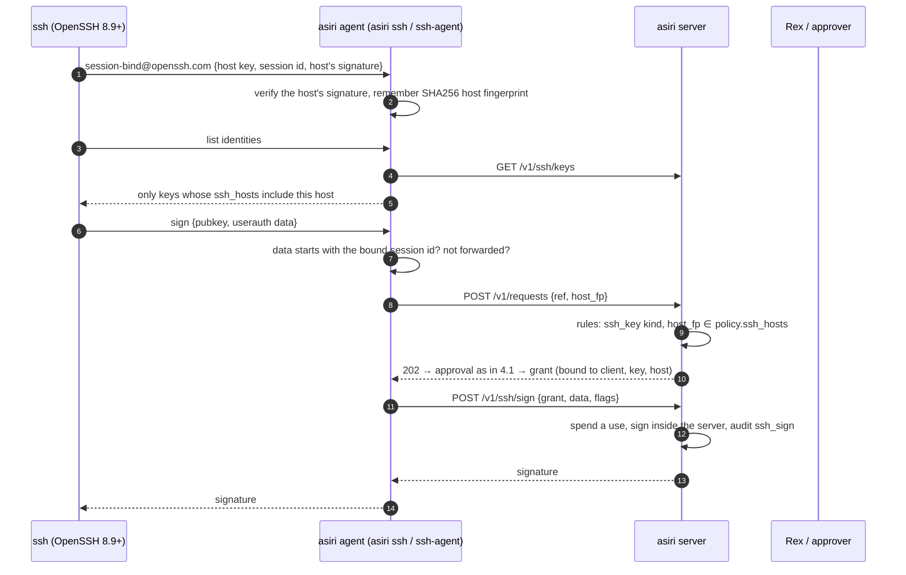

- The private key is generated in the server (`asiri add --ssh-generate`) or imported once (`asiri add --kind ssh_key --stdin`); it is never returned. `POST /v1/grants/{id}/redeem` refuses SSH grants.
- The agent refuses: signing without a session-bind (older OpenSSH, or a client that doesn't send it), data that isn't a login for the bound session (`ssh-keygen -Y sign`, git commit signing), forwarded agent connections, and `ssh-add`.
- `asiri policy REF --ssh-hosts staging` resolves `staging` with `ssh -G` (HostName, Port, HostKeyAlias, UserKnownHostsFile) and `ssh-keygen -F`, and stores `staging=SHA256:…` for each host key found. A host not in known_hosts is refused: connect once with plain ssh to check its key.
- `asiri ssh ARGS` runs ssh with a private agent socket for that one command (`-o IdentityAgent=…`), so approval notes reach the agent's output. `asiri ssh-agent` is a long-running socket for git, rsync and the rest; its approvals go to Rex (or `asiri approve`).

### 4.3 Pairing (once per profile)

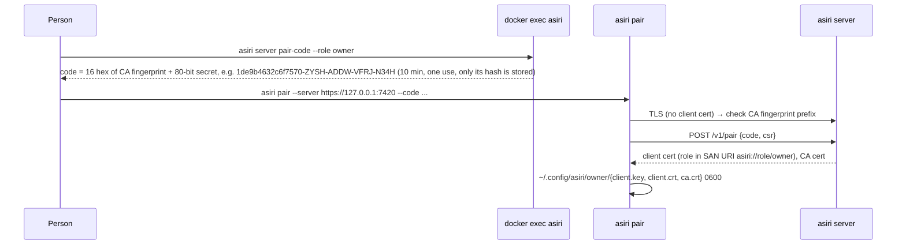

---

## 5. Lifecycles

### Request
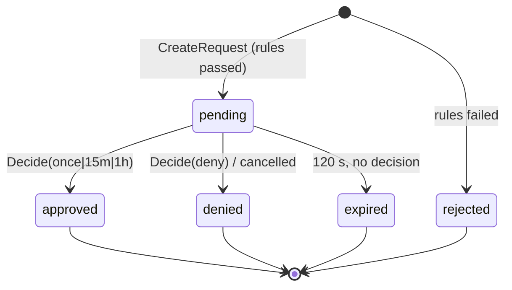

### Grant
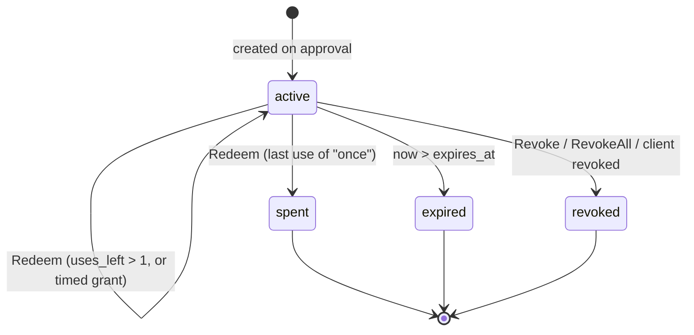

### Server seal state
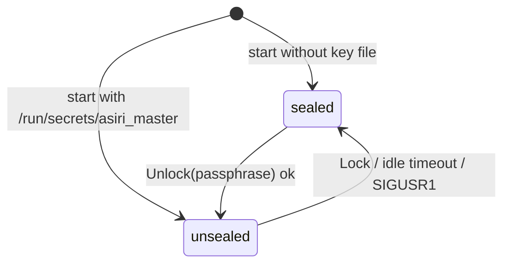

Transitions are an **explicit table** in code (`from, event → to`), checked in one function. Anything not in the table is an error. Sealed state answers every data endpoint with `sealed`.

---

## 6. Data

### Key hierarchy
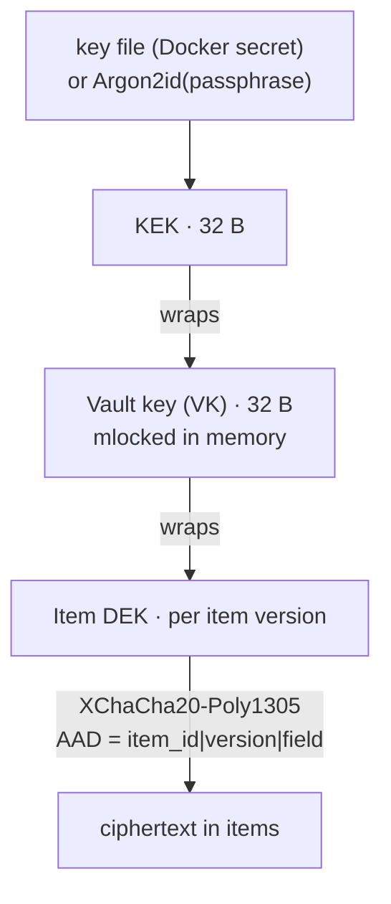
Argon2id: 256 MiB, t=3, p=4. Changing the passphrase rewraps VK only.

### Schema (SQLite, WAL, `foreign_keys=ON`)
```sql
CREATE TABLE meta      (k TEXT PRIMARY KEY, v BLOB);              -- wrapped VK, kdf params, schema version
-- M1 (internal/vault/migrations/001_init.sql)
CREATE TABLE items     (id TEXT, version INT, vault TEXT, name TEXT, field TEXT, kind TEXT,
                        ciphertext BLOB, nonce BLOB, wrapped_dek BLOB, dek_nonce BLOB,
                        created_at INT, deleted_at INT,
                        PRIMARY KEY (id, version),            -- id is stable across versions
                        UNIQUE (vault, name, field, version));
CREATE INDEX items_ref ON items(vault, name, field, version DESC);
CREATE TABLE policies  (item_id TEXT PRIMARY KEY,             -- per item, survives new versions
                        bins TEXT, ssh_hosts TEXT, max_grant TEXT, reveal_to_agent INT);
CREATE TABLE clients   (id TEXT PRIMARY KEY, name TEXT UNIQUE, role TEXT, cert_fp TEXT UNIQUE,
                        created_at INT, revoked_at INT);
CREATE TABLE pair_codes (hash BLOB PRIMARY KEY, name TEXT, role TEXT, expires_at INT, used_at INT);
-- M2 (002_grants.sql): requests and grants also store ref, argv, decision and method for display
-- M4 (003_ssh.sql): items.public_key; requests.host_fp and grants.host_fp; grants_reuse adds host_fp
CREATE TABLE requests  (id TEXT PRIMARY KEY, client_id TEXT, item_id TEXT, bin_path TEXT,
                        bin_sha256 TEXT, host_fp TEXT, argv_preview TEXT, cwd TEXT, reason TEXT,
                        status TEXT, created_at INT, decided_at INT);
CREATE INDEX requests_pending ON requests(status, created_at);
CREATE TABLE grants    (id TEXT PRIMARY KEY, request_id TEXT UNIQUE, client_id TEXT, item_id TEXT,
                        bin_sha256 TEXT, host_fp TEXT, method TEXT, duration TEXT,
                        uses_left INT, expires_at INT, revoked_at INT);
CREATE INDEX grants_reuse ON grants(client_id, item_id, bin_sha256, expires_at);
CREATE TABLE audit     (seq INTEGER PRIMARY KEY, ts INT, client_id TEXT, event TEXT,
                        item_id TEXT, detail TEXT, prev_hash BLOB, hash BLOB);  -- request/grant ids go in detail
```
- IDs are ULIDs (sortable, no coordination).
- Database files are created 0600; WAL and SHM files inherit it.
- **Access patterns → indexes:** "is there a live grant I can reuse?" → `grants_reuse`; "expire stale requests" → `requests_pending`; "latest version of an item" → the unique key.
- `uses_left` is `1` for once, `NULL` for timed grants.
- Audit `detail` never contains values. `argv_preview` is truncated to 200 chars and scrubbed of known values before storing.

### Atomic redeem
```sql
UPDATE grants SET uses_left = CASE WHEN uses_left IS NULL THEN NULL ELSE uses_left - 1 END
 WHERE id = ? AND revoked_at IS NULL AND expires_at > ?
   AND (uses_left IS NULL OR uses_left > 0);
-- rows affected = 0 → spent / expired / revoked; same tx inserts the audit row
```
Decisions use the same shape: `UPDATE requests SET status=? WHERE id=? AND status='pending'`. Zero rows means someone else answered first; return the current state.

---

## 7. API

HTTPS, TLS 1.3 only, client certificate required (except `/v1/pair`). JSON. Errors: `{"error":{"code":"...","message":"..."}}`.

| Method | Path | Role | Notes |
|---|---|---|---|
| GET | `/v1/items?q=` | agent | metadata and policy, never values |
| PUT | `/v1/items/{vault}/{name}` | owner | new version; value in body |
| PUT | `/v1/items/{vault}/{name}/policy` | owner | bins, ssh_hosts, max_grant, reveal_to_agent |
| POST | `/v1/import/{apple\|google}` | owner | CSV body, streamed |
| POST | `/v1/requests` | agent | `Idempotency-Key` header; returns 200 grant / 202 pending / 403 rejected |
| GET | `/v1/requests/{id}?wait=30s` | agent | long poll |
| POST | `/v1/requests/{id}/decision` | owner | first decision wins; agents can never decide, not even their own requests |
| POST | `/v1/grants/{id}/redeem` | agent | not idempotent on purpose |
| POST | `/v1/ssh/sign` | agent | grant + data → signature |
| POST | `/v1/grants/{id}/revoke`, `/v1/revoke-all` | owner | kill switch |
| GET | `/v1/audit?since=`, `/v1/audit/verify` | owner | |
| POST | `/v1/unlock`, `/v1/lock` | owner | |
| POST | `/v1/pair` | none (code) | one-time code |
| GET | `/v1/health` | none | `{sealed: bool, version}` |

Decisions come from the owner's profile: the Rex plugin runs `asiri approve`/`deny` itself (through `rex.exec`), and `asiri approve` runs in the person's terminal. The agent's CLI only waits. See §11.

Error codes: `sealed`, `not_found`, `not_allowed` (bin/host/role), `interpreter_refused`, `denied`, `expired`, `spent`, `revoked`, `rate_limited`, `conflict`.

CLI exit codes (same idea as `docker run`): `125` asiri failed, `126` denied or not allowed, `127` binary not found, anything else is the child's own exit code.

---

## 8. Low-level design

### 8.1 Packages and dependencies
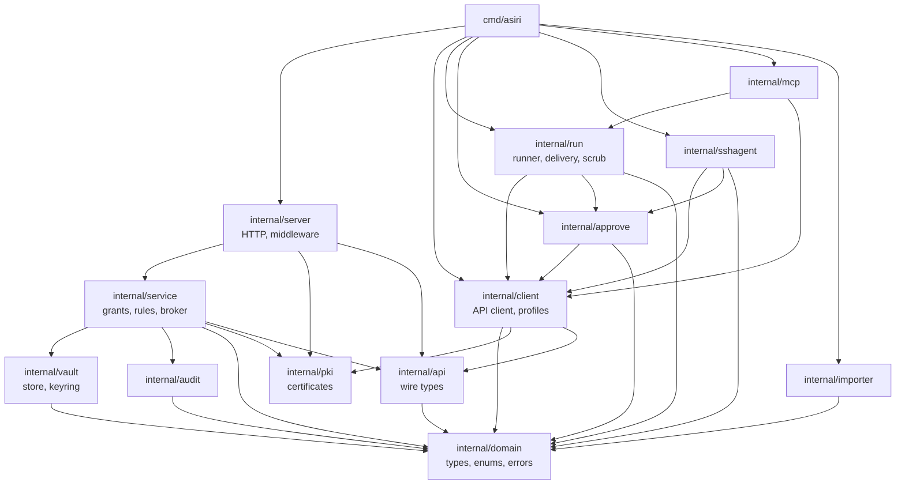
Rule: `domain` imports nothing internal. Server-side and client-side packages never import each other; they share only `domain`.

### 8.2 Domain types (value types, no primitive obsession)
| Type | Responsibility |
|---|---|
| `Ref` | parsed `asiri://vault/name[/field]`; `ParseRef` validates, `String` prints |
| `ItemID`, `ClientID`, `RequestID`, `GrantID` | distinct ULID types so they can't be swapped |
| `Kind` enum | `token`, `password`, `ssh_key`, `login`, `note` |
| `Role` enum | `owner`, `agent` |
| `Duration` enum | `once`, `15m`, `1h`; `Expiry(now)` |
| `RequestStatus`, `GrantState`, `SealState` enums | lifecycle states from §5 |
| `Decision` enum | `once`, `15m`, `1h`, `deny` |
| `Method` enum | `rex`, `tty`, `cli` (later `enclave`) |
| `Secret` | value bytes with `Zero()`; `String()` returns `[redacted]`, no `MarshalJSON` |
| `Item`, `Policy`, `Client`, `Request`, `Grant`, `AuditEvent` | entities matching the schema |
| `Error{Code, Msg}` | typed errors mapped 1:1 to API error codes and exit codes |

`Secret` makes leaking by accident hard: `fmt.Println(secret)`, `slog` and `json.Marshal` all print `[redacted]`. Only `secret.Reveal()` returns bytes, and only `run`, `sshagent` and `vault` call it.

### 8.3 Server side
```mermaid
classDiagram
  class Server {
    +ServeHTTP()
    -mux
  }
  class Middleware {
    <<func>>
    identity · role · ratelimit · recover · log
  }
  class Grants {
    +Create(ctx, Client, RequestInput) Outcome
    +Decide(ctx, RequestID, Decision, Method) Grant
    +Wait(ctx, RequestID, timeout) Request
    +Redeem(ctx, GrantID) Secret
    +Sign(ctx, GrantID, data) Signature
    +Revoke(ctx, GrantID)
  }
  class Rules {
    <<[]Rule>>
    Rule = func(ctx, Client, RequestInput, Item, Policy) error
  }
  class Broker {
    +Subscribe(RequestID) chan Request
    +Publish(Request)
  }
  class Vault {
    +Put(ctx, Ref, Secret) Item
    +Get(ctx, ItemID) Secret
    +List(ctx, query) []Item
    +Unlock(pass) / Lock()
  }
  class Keyring {
    +Seal() / Unseal(kek)
    +WrapDEK() / UnwrapDEK()
    -vk mlocked
    -state SealState
  }
  class Store {
    SQLite · Tx(func(tx))
  }
  class Audit {
    +Append(tx, AuditEvent)
    +Verify(ctx) error
  }
  Server --> Middleware
  Server --> Grants
  Grants --> Rules
  Grants --> Broker
  Grants --> Vault
  Grants --> Audit
  Vault --> Keyring
  Vault --> Store
  Audit --> Store
```

| Type | Responsibility |
|---|---|
| `Server` | HTTP routing and JSON; no business logic |
| middleware funcs | identity from client cert, role check, rate limit, panic recovery, request log (no bodies) |
| `Grants` | the service: request and grant lifecycles, decisions, redeem, sign; owns transactions |
| `Rules` | ordered checks; first failure rejects with a typed error |
| `Broker` | wakes long-poll waiters when a request changes |
| `Vault` | items in and out, encrypt/decrypt through `Keyring` |
| `Keyring` | VK in locked memory, seal state, wrap/unwrap DEKs |
| `Store` | SQLite access and `Tx`; concrete type, no interface |
| `Audit` | append inside the caller's transaction, compute the chain, verify |

### 8.4 Client side
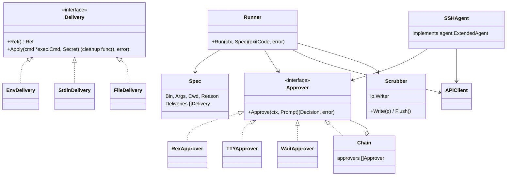

| Type | Responsibility |
|---|---|
| `Runner` | one entry point for `asiri run` and the MCP tool: resolve, check, request, approve, redeem, deliver, exec, scrub, clean up |
| `Delivery` (+3) | how a value reaches the child; returns a cleanup func |
| `Approver` (+3) | asks a person; returns `ErrUnavailable` to let the next one try |
| `Chain` | tries approvers in order, stops at the first real answer |
| `Scrubber` | `io.Writer` that wraps stdout/stderr and replaces known values |
| `APIClient` | typed calls, mTLS, retries only on idempotent calls |
| `SSHAgent` | adapts OpenSSH agent protocol to server-side signing |
| importers | `map[string]func(io.Reader) ([]ImportedItem, error)` for `apple`, `google` |
| `mcp` tools | thin adapters from MCP tool calls to `Runner` and `APIClient` |

### 8.5 Patterns and their forces
| Pattern | Where | Force |
|---|---|---|
| **Strategy** | `Delivery` | the way a secret reaches the child varies per reference and grows (pty, proxy in v0.2) |
| **Strategy + Chain of Responsibility** | `Approver`, `Chain` | which approver works depends on the environment; ordered fallback, each may pass; v0.2 adds Secure Enclave without touching callers |
| **Chain of Responsibility** (as `[]Rule`) | `Rules` | ordered checks that short-circuit on the first failure; the list grows (time windows, anomaly rules) |
| **State** (enum + transition table) | request, grant, seal | real lifecycles with rules; illegal moves must be impossible |
| **Decorator** | `Scrubber` around `io.Writer`; HTTP middleware | add redaction / auth / limits in layers without changing the wrapped thing |
| **Observer** | `Broker` | many long-poll waiters (CLI, ssh-agent) react to one decision |
| **Adapter** | `SSHAgent`, `mcp` tools, CSV importers | third-party interfaces (OpenSSH agent protocol, MCP, vendor CSV columns) |
| **Facade** | `Runner`, `Grants` | complex multi-step flows behind one call for the CLI, MCP and HTTP layers |
| **Simple factory** | importer map, `ParseDelivery("--env NAME=REF")` | pick a concrete type from user input |

### 8.6 Core interfaces (Go)
```go
// internal/run — declared where consumed.
type Delivery interface {
    Ref() domain.Ref
    Apply(cmd *exec.Cmd, s domain.Secret) (cleanup func(), err error)
}

// internal/approve
type Prompt struct {
    RequestID domain.RequestID
    Title     string // "claude wants dev/github"
    Detail    string // "gh pr create · ~/proj/api · open PR"
}
type Approver interface {
    Approve(ctx context.Context, p Prompt) (domain.Decision, error) // ErrUnavailable → try next
}

// internal/service
type Rule func(ctx context.Context, in RuleInput) error
```

---

## 9. Concurrency

### Server
| Shared state | Strategy |
|---|---|
| SQLite writes | one writer connection (`SetMaxOpenConns(1)` on the write pool) plus a small read pool; all state changes in `Store.Tx` |
| Double redeem / double decision | conditional `UPDATE ... WHERE` and rows-affected check; no app-level locks needed |
| Keyring (VK, seal state) | `sync.RWMutex`: readers decrypt concurrently; `Lock`/`Unlock` take the write lock and zero the key |
| Broker waiters | `map[RequestID][]chan Request` behind a `sync.Mutex`; channels buffered (1); publish after commit; subscribers always `select` on `ctx.Done()` |
| Rate limiter | `map[ClientID]*rate.Limiter` behind a mutex (`golang.org/x/time/rate`) |
| Expiry | one ticker goroutine every 5 s: `UPDATE requests SET status='expired' WHERE status='pending' AND created_at < ?`, then publish |
| Shutdown | `http.Server.Shutdown(ctx)`, stop ticker, close store, zero VK |

Lock order: never hold the broker or limiter mutex while in a DB transaction. Publish happens after the transaction commits, so waiters only ever see committed state.

### CLI
- `Runner` runs the child with `exec.CommandContext`. Two goroutines copy stdout and stderr through their own `Scrubber`; an `errgroup` waits for both before returning.
- SIGINT, SIGTERM and SIGHUP are forwarded to the child's process group. A second SIGINT kills it.
- `FileDelivery` cleanup runs in `defer` and on signal; stale `asiri-*` FIFO dirs older than 1 h are removed at the next start.
- `SSHAgent` serves each socket connection in its own goroutine; per-connection state (the bound host key) lives in that goroutine only.

### Scrubber detail
- Patterns: each value as raw, base64 (std, raw std, url, raw url), hex (lower, upper), query- and path-escaped. Values under 4 bytes aren't scrubbed (they would match ordinary output).
- Finds every match with `bytes.Index` (SIMD; ~750 MB/s on an M-series Mac with two values, so no Aho–Corasick needed), then **merges overlapping matches** and replaces each group with its labels. Without merging, base64 padding of one value could swallow the first byte of the next and leak the rest; a fuzz case found this.
- Holds back the last `maxPatternLen-1` bytes between writes, and never commits a group that a later write could still extend; `Flush` on child exit.
- Fuzz test: 8 seeds × 500 cases of random values, encodings and chunk boundaries; no form of any value may survive, and other output must pass unchanged.
- The child's stdout and stderr are pipes, not a terminal, so programs may drop colours or refuse interactive prompts. A pty mode is a later option.

---

## 10. Failure modes

| Failure | Behaviour |
|---|---|
| Server down or unreachable | CLI exits 125: `asiri server not reachable at 127.0.0.1:7420`. No secret, no fallback (fail closed) |
| Server sealed | 125 with `sealed: run asiri unlock` |
| Rex closed / busy / old | `Chain` moves to tty, then wait; the agent sees "waiting for approval: asiri approve <id>" |
| Nobody answers | request expires at 120 s; exit 126 `expired` |
| Two devices answer | first committed decision wins; the second gets `conflict` with the current state |
| CLI crashes after redeem | the once-grant is spent; the value lived only in the CLI and the child; FIFO dir cleaned on next start |
| Child hangs | agent's own timeout kills the CLI; signals are forwarded to the child's group |
| Agent loops on requests | rate limit → `rate_limited` + `anomaly` audit event |
| Stolen agent cert | every use still needs an approval; `asiri clients revoke claude` takes effect on the next request |
| Container crash mid-transaction | SQLite WAL rollback; nothing half-applied, audit included |
| DB corruption / disk loss | `asiri server backup` uses `VACUUM INTO` to an already-encrypted file; `PRAGMA integrity_check` at start |
| Master key or passphrase lost | data unrecoverable by design; `asiri server init` prints a recovery kit (wrapped VK + instructions) to store offline |
| Audit tampered | `asiri log verify` finds the first bad link; it detects, it doesn't prevent; export the head hash elsewhere to be sure |
| Clock skew | server time is the only clock used for expiry; host and container share the kernel clock on Docker Desktop |

---

## 11. Trade-offs

| Chose | Over | Because | Cost |
|---|---|---|---|
| Container server + host CLI | single host binary with Keychain | the person wants smol as a container; delivery must still be on the host | one more moving part; secrets cross the TLS link once per use |
| TCP + mTLS | unix socket | Docker Desktop macOS can't share sockets | cert management (hidden behind `asiri pair`) |
| SQLite | flat encrypted files | atomic updates for grants, indexes, one file to back up | none worth naming at this size |
| Server-side SSH signing | shipping the key to the host agent | key never leaves the container | ~1 ms per sign; needs the server up |
| Long polling | WebSocket / SSE | decisions are rare and short-lived; plain HTTP is simpler | a held connection per waiting request (a handful) |
| Allow-lists + scrubbing | full sandboxing of the child | works today on stock macOS | an allowed binary with its own exfil path (e.g. `gh gist create`) is still a gap |
| `--env` supported | stdin/file only | many tools only read env | env visible to same-user processes via `ps eww` while the child runs; docs say prefer stdin/file |
| Owner-profile approvals (v0.1) | Secure Enclave signed approvals | ship the loop first | agents can't decide through the API, but a process running as the person can read the owner profile's key and approve; fixed in v0.2 (see below) |
| One binary | separate server and client builds | one release, one version, shared `domain` | server code in the client binary (a few MB) |

### v0.2: signed approvals
`Approver` gets a fourth implementation: a small signed macOS helper holding an approval key in the Secure Enclave, Touch ID on every signature. `Decide` then requires `sig = Sign(request_id | item | bin_sha256 | host_fp | decision | expires_at)` from an enrolled key, so holding the owner profile's key is no longer enough. Rex stays as the notification and routing. No caller changes, because the interface already exists.

---

## 12. Deliberately left out (v0.1)

- **`Store` interface.** One implementation; tests use SQLite `:memory:`.
- **Password-manager plugin system.** Two CSV importers are a map of funcs; live adapters come when there is a second real one.
- **Cache, queue, replicas, sharding.** §1 shows ~500× headroom on one SQLite file.
- **WebSockets, gRPC.** Long polling and JSON cover it.
- **Multi-user, teams, sync.** That's asiri:big, a separate design.
- **Header-injecting proxy, `asiri sudo` pty typing, browser logins, rotation, TOTP codes, CI/OIDC.** Later versions; the `Delivery` and `Approver` seams are where they plug in.
- **TUI and web UI.** CLI + Rex only.
- **Config file format.** Profiles are a directory of certs plus a tiny `config.toml` (server URL); nothing else to configure yet.

---

## 13. Repo layout
```
cmd/asiri/              main; `server ...` and client subcommands
internal/domain/        types, enums, errors (imports nothing internal)
internal/api/           JSON wire types shared by server and client
internal/pki/           CA, server and client certificates, CSRs
internal/vault/         store (SQLite), keyring, migrations
internal/service/       grants, rules, broker
internal/server/        HTTP handlers, middleware, TLS, pairing
internal/audit/         hash chain
internal/importer/      apple, google CSV
internal/client/        API client, profiles, pairing
internal/approve/       Approver, Chain, rex, tty, wait
internal/run/           Runner, deliveries, scrubber
internal/sshagent/      agent socket, session-bind, remote signing
internal/mcp/           stdio MCP server
internal/rexplug/       `asiri rex install`: asiri.lua plugin + managed init.lua block
skill/skill.md          agent rules
deploy/                 Dockerfile, compose.yaml
dev/                    go run ./dev ci
```
